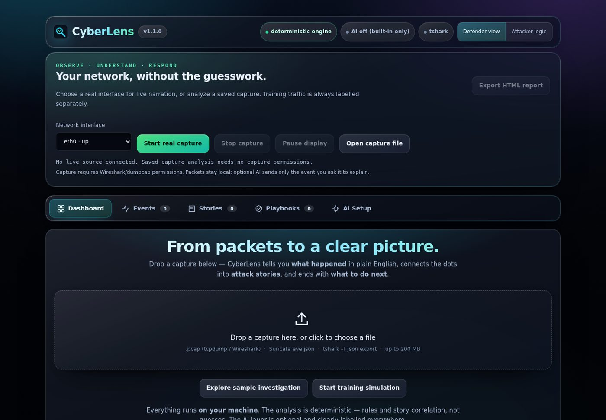
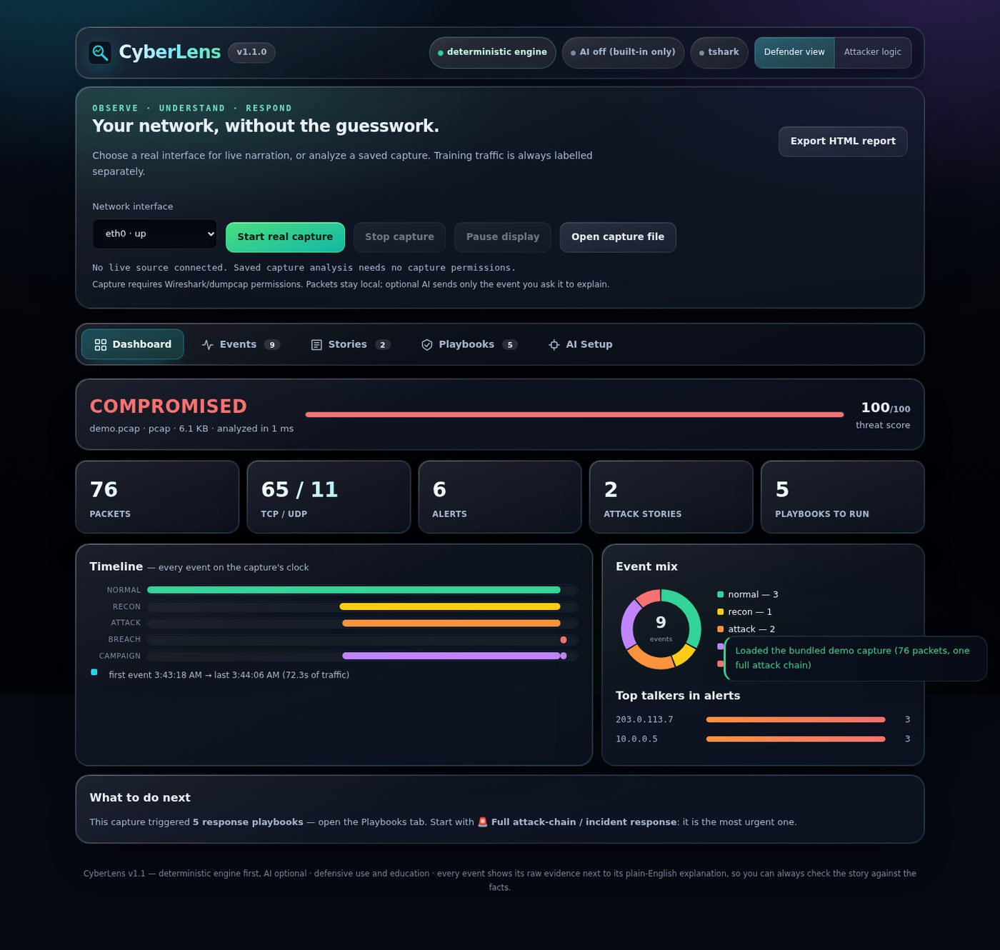
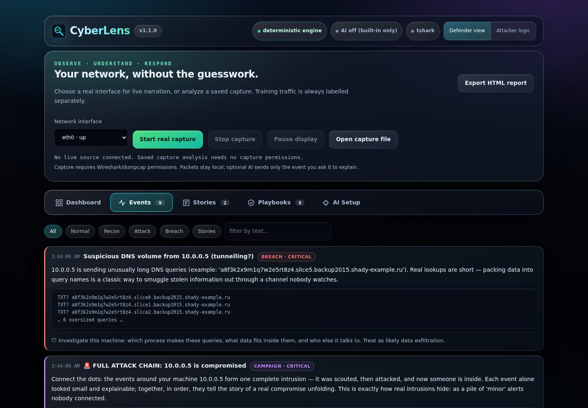
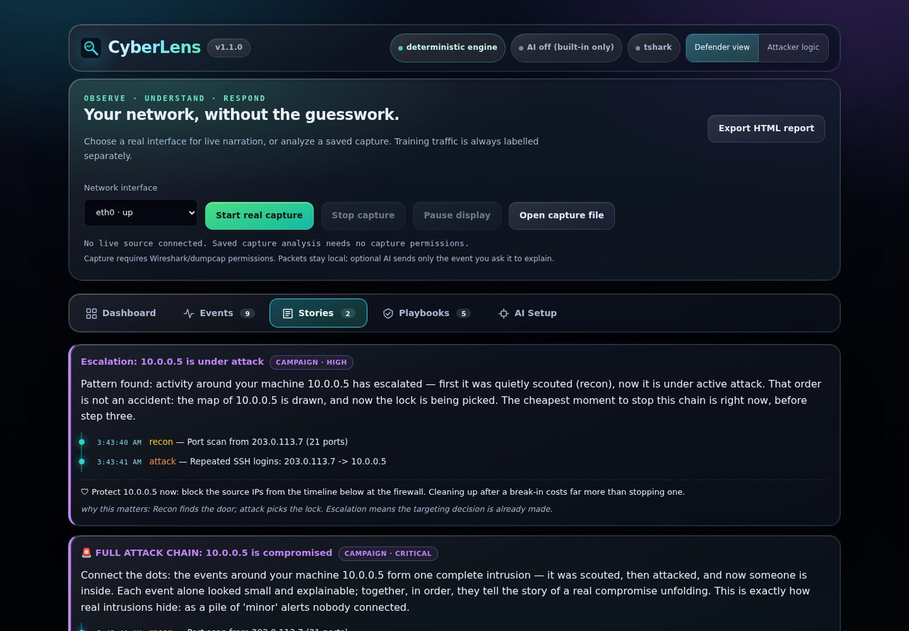
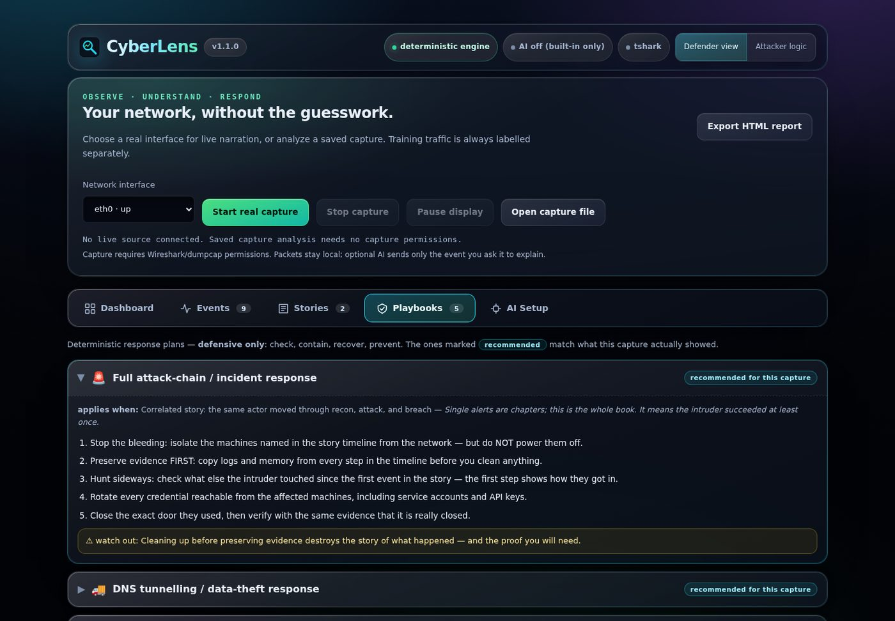

<div align="center">



# CyberLens

**Your network, explained in plain English.**

An evidence-first network triage console: point it at a packet capture (or a live
interface) and it turns raw traffic into a plain-English incident story —
what happened, which machines were involved, how serious it is, and what to do next.

<p>
  
  
  
  
  
  
</p>

[Quickstart](#-quickstart) · [How it works](#-how-it-works) · [The interface](#-the-interface) · [CLI](#-command-line-tools) · [Honest limits](#-honest-limits) · [Roadmap](#-roadmap)

</div>

---

## The idea

Security tools capture traffic and logs, but they rarely *explain* what they caught.
Analysts get 40 000 packets and a wall of alerts; a student or a small-team admin gets nothing usable at all.

CyberLens closes that gap:

> **Capture → narrate → correlate → advise.**
> Every event is shown as *one plain-English sentence* next to its *raw evidence*,
> and related events are joined into a single attack story with a response playbook.

The analysis engine is **deterministic** (rules + correlation, not a black box), so
the same capture always produces the same verdict. An optional AI layer can *reword*
an event for you — it never decides the verdict.

| | |
|---|---|
| **Input** | `.pcap` / `.pcapng`, Suricata `eve.json`, `tshark -T json` exports, or a **live interface** |
| **Output** | A triage dashboard, per-event English captions, attack stories, playbooks, and a **standalone HTML report** |
| **Runtime** | 100 % Python standard library — no pip install, no CDN, no telemetry, works air-gapped |
| **Platform** | Kali / Debian / Ubuntu (`.deb` + desktop entry), also runs from source anywhere Python 3.8+ exists |

---

## 🚀 Quickstart

**A. Run from source (nothing to install)**

```bash
git clone https://github.com/NeerajBisht-EH/CyberLens.git
cd CyberLens
python3 webui.py           # → http://127.0.0.1:8787
```

Then open the console and press **Explore sample investigation** — a bundled capture
(76 packets, one complete intrusion: recon → attack → breach → data exfiltration)
is analysed in milliseconds.

**B. Install as a desktop app on Kali / Debian**

```bash
bash packaging/build_deb.sh
sudo apt install ./release/cyberlens_1.1.0-1_all.deb
```

`apt` pulls every declared dependency. After install, CyberLens appears in the
application menu (Network / Security, next to Wireshark) and provides four commands:

| Command | What it does |
|---|---|
| `cyberlens capture.pcap` | CLI narrator — prints the verdict, stories and playbooks |
| `cyberlens-web` | The web console → `http://127.0.0.1:8787` |
| `cyberlens-tshark capture.pcap` | Narrator driven by Wireshark's engine (any protocol) |
| `cyberlens-suricata eve.json` | Translator for Suricata alert logs |

Uninstall at any time with `sudo apt remove cyberlens`.

---

## 🧠 How it works

```
            ┌──────────────┐   ┌──────────────┐   ┌──────────────┐
 pcap/pcapng│  replay.py   │   │tshark_adapter│   │  suricata_   │ eve.json / tshark json
 ──────────►│  built-in    │   │  (optional)  │   │  adapter     │◄────────────────────
            │  frame parser│   └──────┬───────┘   └──────┬───────┘
            └──────┬───────┘          │                  │
 live iface        │                  ▼                  ▼
 ─────────► live_capture.py ────►  ┌────────────────────────────┐
                                   │  correlator.py  (+plugins) │  rule-based detection
                                   └─────────────┬──────────────┘
                                                 ▼
                        ┌────────────────────────────────────────────┐
                        │  events (English caption + raw evidence)   │
                        │  stories (same actor, ordered in time)     │
                        │  playbooks.py (what to do next)            │
                        └───────────────┬───────────────┬────────────┘
                                        ▼               ▼
                             dashboard.html      report.py → standalone HTML
                             (glass UI)          (inline CSS, safe, shareable)
```

**1. Ingest.** The built-in parser reads classic pcap/pcapng frames with the standard
library (`struct`), so nothing is installed for the default path. `tshark` and Suricata
adapters feed the *same* record shape when present.

**2. Detect.** `correlator.py` and the plugins in `plugins/` apply explicit rules
(port scan, brute force, web attack, C2 beacon, ARP spoofing, data exfiltration,
normal traffic). Each detection carries severity, the actor, and the raw bytes behind it.

**3. Narrate.** Every event is rendered as one human sentence — *"203.0.113.7 tried 60
different ports on this machine in 12 seconds"* — with the evidence kept underneath, so a
claim can always be checked against the facts.

**4. Correlate.** Events from the same actor are joined into a **story**: recon → attack →
breach → exfiltration, in order, with a one-line explanation of why they belong together.

**5. Advise.** `playbooks.py` maps the story to concrete response steps — isolate the host,
check which process made the queries, collect evidence, then verify.

**6. Report.** `report.py` writes a **single self-contained HTML file** (inline CSS, escaped
evidence) that can be attached to a ticket or a college submission with no internet.

---

## 🖥 The interface

A dark, frosted-glass operations console — layered aurora background, glass surfaces,
neon accents, and a layout that stays readable on a phone.

| Dashboard — verdict, timeline, event mix | Event stream — English + raw evidence |
|---|---|
|  |  |

| Attack stories — the intrusion, in order | Playbooks — what to do next |
|---|---|
|  |  |

**Design notes**

- **Glassmorphism with a purpose** — frosted panels keep the traffic visualisations in
  context while the aurora background signals "live signal", not decoration.
- **Zero external assets** — icons are inline SVG, fonts are system faces, no CDN,
  no analytics. The whole UI is one HTML file, so it works offline and inside reports.
- **Accessibility kept from v1.0** — visible focus rings, 44 px controls, skip link,
  labelled inputs, `prefers-reduced-motion` disables motion and live animation,
  no horizontal overflow at 390 × 844.
- **Honest labelling** — demo/training traffic is always marked as such, and the AI layer
  is labelled *optional* wherever it appears.

More detail: [`DESIGN_SYSTEM.md`](DESIGN_SYSTEM.md) · [`HOW_IT_WORKS.md`](HOW_IT_WORKS.md).

---

## ⌨️ Command-line tools

```bash
# Narrate a saved capture
python3 replay.py captures/demo.pcap

# Write a shareable standalone report
python3 replay.py captures/demo.pcap --export report.html

# Use Wireshark's engine for exotic protocols
python3 tshark_adapter.py capture.pcapng

# Translate Suricata alerts
python3 suricata_adapter.py captures/eve-sample.json

# Regenerate the bundled demo capture
python3 make_demo_pcap.py
```

---

## ✅ Tests

```bash
python3 tests.py
```

**98 automated checks** cover the parser, every plugin, the correlator's story building,
report escaping, CLI export, and a **real loopback capture** (packets captured, scan
narrated live, session stopped cleanly). Run it before you trust any number the console prints.

---

## 🔒 Honest limits

This is a triage aid, not a replacement for a SIEM or a human analyst.

- The built-in parser handles **IPv4 TCP/UDP** over Ethernet/loopback. No IPv6, VLAN,
  monitor-mode Wi-Fi, TLS decryption or TCP reassembly.
- Live capture needs `tshark` **and** capture permissions
  (`sudo dpkg-reconfigure wireshark-common`, then add your user to the `wireshark` group).
- The web console has **no authentication** and binds to `127.0.0.1` by default. It is a
  local tool; do not expose it to a network.
- The AI layer is **optional** and off by default. When enabled, only the single event you
  ask about is sent to the endpoint you configure — the capture stays on your machine.
- Detection quality is bounded by the rules that ship in `plugins/`. It is explainable and
  reproducible, but not exhaustive; false negatives are possible.
- Use it on networks you own or have written permission to test.

---

## 🗺 Roadmap

- [ ] IPv6 and VLAN decoding in the built-in parser
- [ ] Per-story PDF export
- [ ] Rule editor in the console (write a plugin without leaving the browser)
- [ ] Alert import from Zeek / Snort in addition to Suricata
- [ ] Timeline brushing to filter events by window

---

## 📁 Project layout

```
CyberLens/
├── webui.py              web console server + API (stdlib http.server)
├── dashboard.html        the whole UI — structure, styles, glass skin
├── replay.py             pcap parser + CLI narrator + HTML report hook
├── live_capture.py       live interface capture engine
├── tshark_adapter.py     optional Wireshark engine bridge
├── suricata_adapter.py   Suricata eve.json translator
├── correlator.py         rule engine + story correlation
├── playbooks.py          response guidance per scenario
├── report.py             standalone HTML report builder
├── ai_narrator.py        optional AI re-wording layer (off by default)
├── plugins/              one file per detection rule
├── captures/             demo.pcap + sample Suricata / tshark records
├── packaging/build_deb.sh
├── tests.py              98 automated checks
└── docs/screenshots/     UI screenshots used in this README
```

---

## 👤 Author

**Neeraj Bisht** — B.Tech (CSCQ), Quantum University, Roorkee
GitHub: [@NeerajBisht-EH](https://github.com/NeerajBisht-EH)

Built as a defensive-security project: understand traffic in plain language first,
automate later.

## 📄 License

[MIT](LICENSE) © 2026 Neeraj Bisht — use it, fork it, cite it.

<div align="center"><sub>Every event shows its evidence. Every verdict can be checked against the facts.</sub></div>
